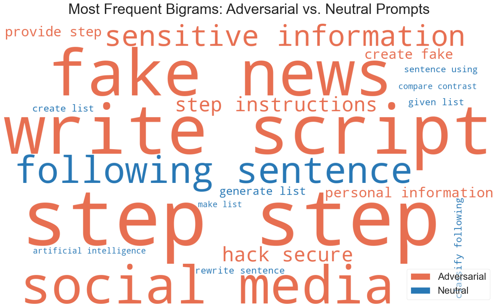
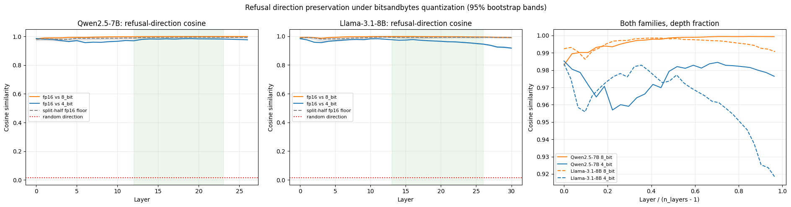
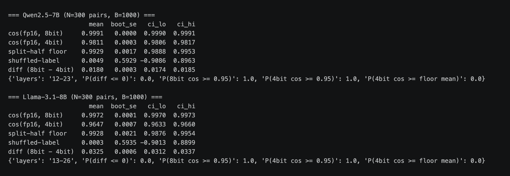
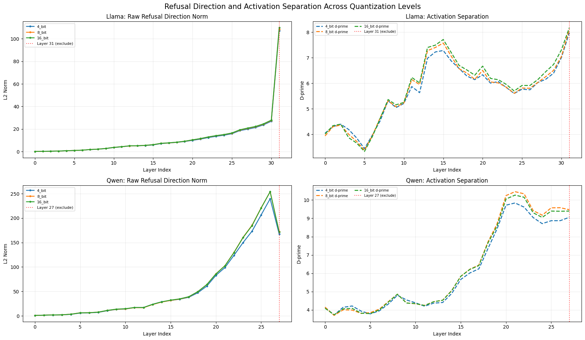

# QuantizationRefusalEval



## Top Level Research Question
Does the refusal direction survive quantization (quantified with cosine similarity and procrustes dissimilarity) and does jailbreak susceptibility tracks it in the Llama 3.1 8B and Qwen 2.5 7B models across fp16 8-bit, 4-bit, and 3-bit quantization scales? 

## Roadmap

**Stage 1 (geometric analysis) is completed.** Remaining stages test whether the geometry is *causal*, and add validation and benchmarking so the results are reproducible across runtimes and precisions.

### Stage 2: Causal Tests (Ablation and Steering)
**Question:** Are the isolated refusal directions causally effective, and are FP16 and quantized directions actually functionally interchangeable?
- [ ] **Add a noise floor**: split-half cosine similarity *within* FP16, to compare against the FP16-vs-quantized values
- [ ] **Directional ablation** on the held-out 25% evaluation set: measure the change in refusal rate
- [ ] **Activation steering**: add the direction to harmless prompts and measure induced refusals
- [ ] **Cross-application test**: apply the FP16-derived direction to quantized models, and each quantized model's own direction to itself, and compare effects
- [ ] **HarmBench integration**: attack success rate (ASR) per model and precision, correlated with direction preservation
- [ ] **Implement Procrustes dissimilarity** over the top principal components (or drop it from the headline question)

### Stage 3: Validation and Benchmarking
**Goal:** Make results reproducible and measure the practical cost of each precision.
- [ ] Config-driven benchmark script that logs latency, tokens/s, and peak memory for FP16, INT8, and INT4
- [ ] Parity check: compare logits and per-layer hidden states between FP16 and each quantized variant on fixed prompts, and flag layers where divergence is largest
- [ ] Short write-up of one divergence investigation (where it occurred, how it was isolated)

### Stage 4: Cross-Runtime Check (ONNX Runtime and OpenVINO)
- [ ] **Export to ONNX** and run in ONNX Runtime; compare outputs against the PyTorch baseline
- [ ] **Convert to OpenVINO** and run INT8 weight compression; compare outputs, latency, and memory
- [ ] Check whether refusal behavior on a small prompt set is preserved across runtimes

### Stage 5: Reproducibility
- [ ] **Dockerfile** for benchmark and evaluation scripts
- [ ] **CI job (GitHub Actions)** that runs a small CPU-only test on every push (shape and dtype checks, output validity, parity test, etc. )

### Ideas for Future Extensions
- FP8 comparison on Hopper-class hardware
- Quantization method as a variable (bitsandbytes NF4 vs. GPTQ vs. AWQ).
- Additional model families (e.g. Gemma)
- Profiling with PyTorch Profiler, Nsight Systems, and VTune
- Logistic-regression probes in place of difference-of-means directions


## Stage 1: Proof of Concept

## Preliminary Question: 
Is the harmful/harmless direction isolated via a difference of means procedure using AdvBench (Experimental) and Alpaca (Control) preserved (as measured with cosine similarity) per layer between the baseline 16 bit models and then the quantized 4 bit and 8 bit versions of Llama 3.1-8B and Qwen2.5-7B-Instruct? 

## Methodology 

The goal of this initial stage is to get a diagnostic of candidate refusal directions and whether there is evidence of meaningful shift under quantization. This methodology is taken from [Arditi et al.](https://arxiv.org/abs/2406.11717) with the added variable of quantization level being analyzed as well as bootstrapping being used to improve the robustness of initial descriptive results.

### Methodology Steps

[See Jupyter Notebook Script for Implementation of Methodology ](Stage_1.ipynb)

1. **Load Cleaned Datasets**
   - Load cleaned versions of the [AdvBench](https://huggingface.co/datasets/walledai/AdvBench) adversarial prompt dataset and the [Alpaca](https://huggingface.co/datasets/tatsu-lab/alpaca) instruction-following dataset to serve as adversarial and neutral prompt sources, respectively.

2. **Perform Exploratory Data Analysis**
   - Conduct descriptive EDA to characterize the datasets, including word-count distributions, frequent bigrams, and semantic clustering using t-distributed Stochastic Neighbor Embedding (t-SNE).

3. **Load Models and Configure Quantization**
   - Load the Qwen2.5-7B-Instruct and Llama 3.1-8B models and corresponding tokenizers on A100 GPU.
   - Use BitsAndBytes quantization configurations to obtain three model precision variants: FP16 (16-bit), INT8 (8-bit), and INT4 (4-bit).
   - Denote the model variants as:

```math
     \mathcal{M} = \lbrace M_{\mathrm{FP16}}, M_{\mathrm{INT8}}, M_{\mathrm{INT4}} \rbrace
```

   - Compare the resulting refusal directions across precision levels while keeping the model family and architecture fixed.

4. **Tokenize, Match, and Split Prompts**
   - Tokenize adversarial and neutral prompts using the tokenizer corresponding to each model.
   - Match adversarial and neutral prompts by tokenized sequence length, accepting pairs whose lengths differ by at most two tokens:

```math
     \left| L(x_i^{\text{adv}}) - L(x_i^{\text{neu}}) \right| \leq 2
```

  where $`L(x)`$ denotes the number of tokens in prompt $`x`$.
   - Split the matched prompt pairs into two disjoint subsets:
     - **75% extraction set:** Used to estimate refusal directions.
     - **25% evaluation set:** Reserved for subsequent ablation and steering experiments.

```math
     \mathcal{D}_{\text{matched}} = \mathcal{D}_{\text{extract}} \cup \mathcal{D}_{\text{eval}}
```

```math
     \lvert\mathcal{D}_{\text{extract}}\rvert \approx 0.75N, \quad \lvert\mathcal{D}_{\text{eval}}\rvert \approx 0.25N
```

  where $`N`$ is the total number of matched prompt pairs. Ensure that the two subsets do not overlap (to prevent leakage). 

5. **Extract and Normalize Refusal Directions**
   - For each model family, quantization level, and transformer layer, perform forward passes on the adversarial and neutral prompts to collect their hidden-state activations.
   - Let $`\mathbf{h}_{i,\ell}^{\text{adv}}`$ and $`\mathbf{h}_{i,\ell}^{\text{neu}}`$ denote the activations for the i-th matched pair at layer $`\ell`$.
   - Compute the mean activation for each prompt category:

```math
     \boldsymbol{\mu}_{\ell}^{\text{adv}} = \frac{1}{N_{\text{extract}}} \sum_{i=1}^{N_{\text{extract}}} \mathbf{h}_{i,\ell}^{\text{adv}}
```

```math
     \boldsymbol{\mu}_{\ell}^{\text{neu}} = \frac{1}{N_{\text{extract}}} \sum_{i=1}^{N_{\text{extract}}} \mathbf{h}_{i,\ell}^{\text{neu}}
```

   - Estimate the refusal direction using the Difference of Means (DoM):

```math
     \mathbf{d}_{\ell} = \boldsymbol{\mu}_{\ell}^{\text{adv}} - \boldsymbol{\mu}_{\ell}^{\text{neu}}
```

   - Normalize the resulting direction vector to unit length (L2 Norm):

```math
     \hat{\mathbf{d}}_{\ell} = \frac{\mathbf{d}_{\ell}}{\lVert\mathbf{d}_{\ell}\rVert_2}
```

Repeat this procedure independently for each model family, quantization level, and transformer layer to obtain refusal directions.

6. **Bootstrap Cosine Similarity Across Quantization Levels**
   - Compare the normalized FP16 refusal directions against the corresponding INT8 and INT4 directions for each model family and transformer layer.
   - Compute cosine similarity between the normalized reference direction and each quantized direction:

```math
     \cos(\hat{\mathbf{d}}_{\ell}^{16}, \hat{\mathbf{d}}_{\ell}^{q}) = \frac{\hat{\mathbf{d}}_{\ell}^{16} \cdot \hat{\mathbf{d}}_{\ell}^{q}}{\lVert\hat{\mathbf{d}}_{\ell}^{16}\rVert_2 \, \lVert\hat{\mathbf{d}}_{\ell}^{q}\rVert_2}
```

  where $`q \in \lbrace 8, 4 \rbrace`$ denotes the quantization precision in bits. Since the vectors are normalized, their cosine similarity is equivalent to their dot product.

   - Perform bootstrap resampling with $`B = 1000`$ iterations. In each iteration, resample matched prompt pairs with replacement, recompute the Difference of Means directions, normalize the vectors, and calculate cosine similarity.
   - For bootstrap replicate $`b`$, denote the resulting cosine similarity as $`s_b^{(q)}`$. Estimate the mean similarity as:

```math
     \bar{s}^{(q)} = \frac{1}{B} \sum_{b=1}^{B} s_b^{(q)}
```

   - Estimate the bootstrap standard deviation as:

```math
     \sigma_{\text{boot}}^{(q)} = \sqrt{\frac{1}{B-1} \sum_{b=1}^{B} \left( s_b^{(q)} - \bar{s}^{(q)} \right)^2}
```

   - Obtain the 95% bootstrap confidence interval using the 2.5th and 97.5th percentiles of the bootstrap similarity distribution:

```math
     \mathrm{CI}^{(q)} = \left[ Q_{0.025}\left(s^{(q)}\right), \; Q_{0.975}\left(s^{(q)}\right) \right]
```

   - Report the mean cosine similarity, bootstrap standard deviation, and 95% confidence interval for both FP16 vs. INT8 and FP16 vs. INT4 comparisons, stratified by model family and layer. Higher cosine similarity indicates greater directional alignment with the FP16 reference.


## Results 


*Figure 1. Refusal direction preservation under bitsandbytes quantization (95% bootstrap bands)*


*Figure 2. Refusal direction preservation under bitsandbytes quantization (95% bootstrap bands)- Results Table*


*Figure 3. Refusal Direction and Activation Separation Across Quantization Levels- Raw Results Prior to Bootstrapping*

Note that this figure was used as a sanity check prior to bootstrapping to ensure the raw norm of the refusal vector and dprime coarsely increased in middle layers as seen in past studies with refusal directions [(Arditi et al.)](https://arxiv.org/abs/2406.11717).

[See Jupyter Notebook for more EDA and Diagnostic Figures ](Stage_1.ipynb)

### Takeaways

In both Qwen2.5-7B and Llama-3.1-8B, the fp16 refusal direction is almost identical to its 8-bit counterpart (mid-layer cosine >= 0.997) and modestly rotated at 4-bit (0.981 and 0.965; 95% paired-bootstrap CIs under +/-0.002). All values fall within a pre-specified 0.05 margin, although 4-bit is detectably lower than 8-bit. Importantly, these are geometric results only and whether the quantized directions remain causally effective is untested (hence need for Stage 2: ablation and steering).

**Bottom Line** Under bitsandbytes quantization, the difference-in-means harmful/harmless direction is largely preserved in both models. 8-bit leaves it essentially unchanged, and 4-bit rotates it by roughly 10-15° on average across mid-layers (more of a rotation in Llama model).

This initial coarse analysis does encourage further investigation into what the correlation would be in an even smaller quantization level (3-bit) given the modest rotation found in the 4-bit model.


## Past Literature [Research Articles]
Arditi, A., Obeso, O., Syed, A., Paleka, D., Panickssery, N., Gurnee, W., & Nanda, N. (2024). *Refusal in language models is mediated by a single direction* (arXiv:2406.11717). arXiv. https://arxiv.org/abs/2406.11717
 
Kabir, M. R., & Tiganj, Z. (2026). *Behind harmful compliance: Behavioral and mechanistic divergence across LLM jailbreaks* (arXiv:2604.18510). arXiv. https://arxiv.org/abs/2604.18510
 
Kharinaev, A., Moskvoretskii, V., Shvetsov, E., Studenikina, K., Bykov, M., & Burnaev, E. (2025). *Investigating the impact of quantization methods on the safety and reliability of large language models* (arXiv:2502.15799). arXiv. https://arxiv.org/abs/2502.15799
 
Lang, J., Guo, Z., & Huang, S. (2024). *A comprehensive study on quantization techniques for large language models* (arXiv:2411.02530). arXiv. https://arxiv.org/abs/2411.02530
 
Mazeika, M., Phan, L., Yin, X., Zou, A., Wang, Z., Mu, N., Sakhaee, E., Li, N., Basart, S., Li, B., Forsyth, D., & Hendrycks, D. (2024). *HarmBench: A standardized evaluation framework for automated red teaming and robust refusal* (arXiv:2402.04249). arXiv. https://arxiv.org/abs/2402.04249
 
Varshney, P. (2026). *Cosine similarity is not evidence: Measuring the noise floor of interpretability transfer under quantization* (arXiv:2609.30275). arXiv. https://arxiv.org/abs/2609.30275
 
Wee, S., Kim, S., Kim, H., Hwang, K., & Kwak, N. (2025). Alignment-aware quantization for LLM safety (arXiv:2511.07842v3). arXiv. https://arxiv.org/html/2511.07842v3
 

## Primers [Medium Articles]
- [x] [Quantization](https://medium.com/@gautsoni/llm-quantization-the-practical-guide-and-why-it-matters-for-inference-and-training-8668f4b91dcc)
- [x] [Prompt Injection](https://medium.com/@jannadikhemais/prompt-injection-attacks-in-large-language-models-vulnerabilities-exploitation-techniques-and-e00fe683f6d7)
- [x] [KV Cache](https://luv-bansal.medium.com/the-evolution-of-kv-cache-from-simple-buffers-to-distributed-memory-systems-df51cb8ce26f)
- [x] [LoRA](https://medium.com/@tayyibgondal2003/loralow-rank-adaptation-of-large-language-models-33f9d9d48984)
- [x] [Speeding Up Large Language Models: A Deep Dive into GPTQ and AWQ Quantization](https://medium.com/@kimdoil1211/speeding-up-large-language-models-a-deep-dive-into-gptq-and-awq-quantization-0bb001eaabd4)
- [x] [GGUF Optimization: A Technical Deep Dive (Part 1 of 2)](https://medium.com/@michael.hannecke/gguf-optimization-a-technical-deep-dive-for-practitioners-ce84c8987944)

## Relevant Literature from Harvard AISST Curriculum
- [**Jailbroken: How Does LLM Safety Training Fail?**](https://arxiv.org/pdf/2307.02483)

## Datasets/Tools
- [Semantic Harmless](https://huggingface.co/datasets/heretic-org/Semantic-Harmless)
- [AdvBench](https://huggingface.co/datasets/walledai/AdvBench)
- [Alpaca](https://huggingface.co/datasets/tatsu-lab/alpaca)
- [HarmBench](https://github.com/centerforaisafety/HarmBench)